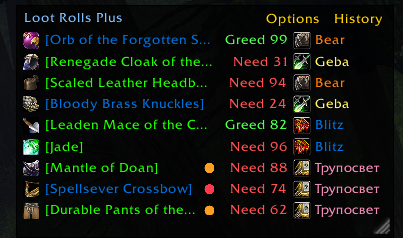
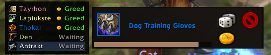
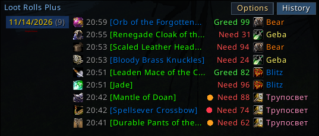

  

<h1 align="center">Loot Rolls Plus</h1>

Live loot rolls, equipment checks and group history for WoW Forever.

  <a href="https://github.com/Antrakt92/LootRollsPlus/releases/latest"><strong>Download</strong></a>
  · <a href="https://www.curseforge.com/wow/addons/loot-rolls-plus"><strong>CurseForge</strong></a>
  · <a href="https://github.com/Antrakt92/LootRollsPlus/issues"><strong>Report a problem</strong></a>

  
  

  <a href="#live-rolls-and-history">Features</a>
  · <a href="#installation">Install</a>
  · <a href="#commands">Commands</a>

## Live rolls and history

- **Party:** see who picked Need, Greed or Pass beside the game's loot prompt.
- **Raid:** see totals and the leading Need rolls. Click the summary for the player list.
- **Equipment:** click a player on an equippable drop to inspect the matching slot. Hover the game's item icon to see the drop.
- **History:** switch dates and browse rolls by dungeon or raid visit. Hover for participants, or click for side-by-side item tooltips.
- **Need warnings:** red marks equipment the class cannot use. Orange marks armor below its usual tier. The game determines the winner.

Choices and numbers appear as the game reports them. Loot Rolls Plus tries to inspect players who choose Need and the winner while the drop is recent. History shows the saved equipment when the inspection succeeds. Auctionator and Mastercraft can add prices to the dropped item's comparison tooltip.

## Installation

For **WoW Forever 1.60.1**. Install from CurseForge or extract the addon ZIP from GitHub Releases into `Interface/AddOns`. Restart the client for a first installation.

To import saved per-character rolls, open the game once with Loot Rolls Inspector and Loot Rolls Plus both enabled. You can disable Loot Rolls Inspector after the import.

To restore a hidden window, open **Settings → AddOns → Loot Rolls Plus** and click **Show Roll Window**.

## Commands

| Command | Action |
| --- | --- |
| `/lrplus` | Toggle the roll window |
| `/lrplus show` | Restore the roll window and turn off hiding outside a group |
| `/lrplus history` | Open history |
| `/lrplus config` | Open options |
| `/lrplus demo party` | Preview party rolls |
| `/lrplus demo raid` | Preview a 40-player raid |
| `/lrplus demo off` | Close the preview |
| `/lrplus import` | Retry the history import |

## Credits

Based on [Loot Rolls Inspector](https://www.curseforge.com/wow/addons/loot-rolls-inspector) by Carlos (mr_mirror). [MIT license](LICENSE) · [Changelog](CHANGELOG.md).
